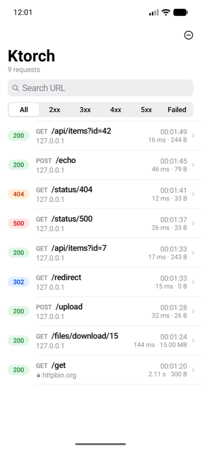
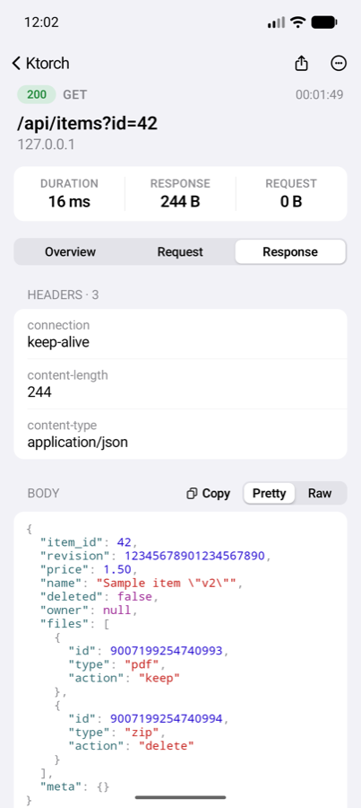
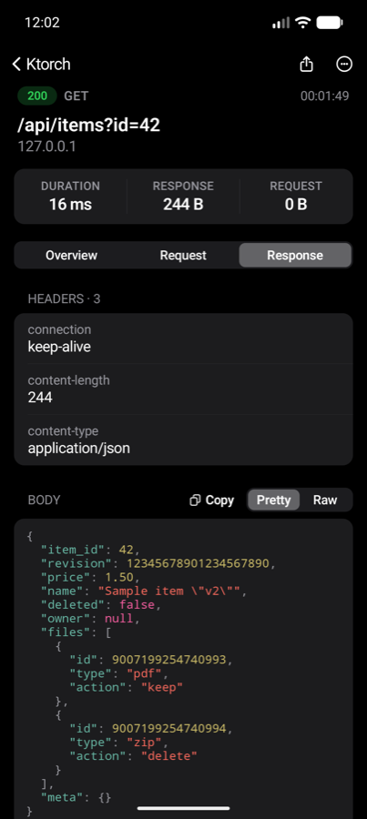
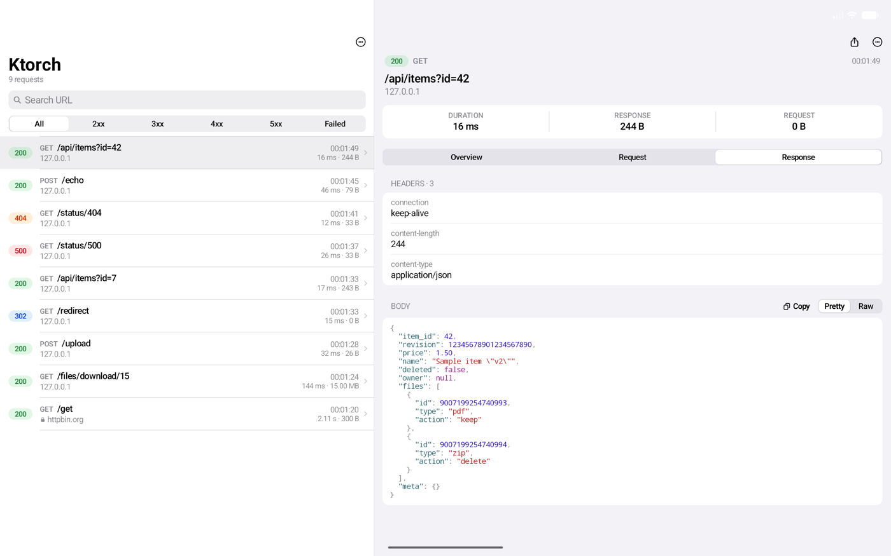
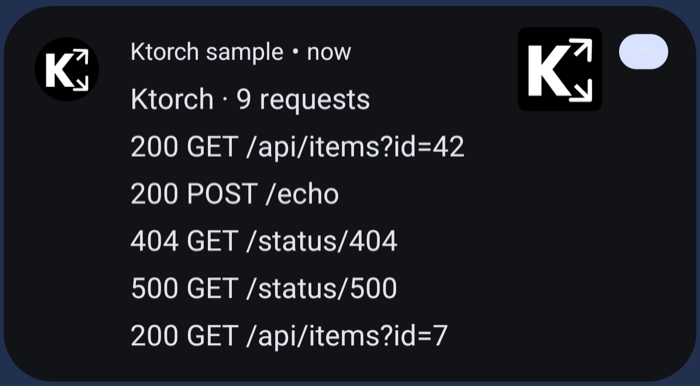

# Ktorch

**Ktor + torch.** An in-app HTTP inspector for Android apps that use Ktor 3. It does for Ktor what
[Chucker](https://github.com/ChuckerTeam/chucker) does for OkHttp. Because it is a plain Ktor
client plugin, it works with any engine: OkHttp, CIO, Android, and so on.

<p>
  
  
  
</p>
<p>
  
</p>
<p>
  
</p>

The interface follows Apple's design language: black and white carry the UI, and color is used
only for meaning. Status badges use iOS system colors (green 2xx, blue 3xx, orange 4xx, red 5xx),
and JSON uses Xcode's syntax colors, in both light and dark mode.

- The app always receives every response body **byte for byte**, and Ktor 3's saved bodies can
  still be read more than once. Both are covered by tests.
- Large downloads are never held in memory. Body capture has a hard size cap and can be
  skipped per host or path.
- The JSON viewer never changes values: `12345678901234567890` and `1.50` show exactly as
  the server sent them.
- A no-op artifact for release builds exposes the same API, so the same call sites compile
  in every variant.

## Install

JitPack:

```kotlin
// settings.gradle.kts
dependencyResolutionManagement {
    repositories {
        google()
        mavenCentral()
        maven { url = uri("https://jitpack.io") }
    }
}
```

Wire it the same way as Chucker:

```kotlin
dependencies {
    debugImplementation("com.github.phiraphongbenzz.ktorch:library:<tag>")
    releaseImplementation("com.github.phiraphongbenzz.ktorch:library-no-op:<tag>")

    // Optional: keep requests across app restarts (Room 2.6.1)
    debugImplementation("com.github.phiraphongbenzz.ktorch:library-room:<tag>")
}
```

## Use

```kotlin
// A top-level client is fine: no Context needed (see "Context" below).
val client = HttpClient(OkHttp) {
    install(ContentNegotiation) { json(Json { ignoreUnknownKeys = true }) }
    install(HttpTimeout) { requestTimeoutMillis = 240_000 }
    install(NetworkInspector) {
        maxContentLength = 250_000                                  // bytes kept per body
        skipHosts += "storage.example.com"                          // presigned file downloads
        skipPathPrefixes += "/files/download"                       // large streamed files
    }
}

// Open the inspector from a debug menu, a shake gesture, etc.
NetworkInspector.launchUI(context)
```

Tapping the notification also opens the inspector. The notification only appears if the app
itself holds `POST_NOTIFICATIONS`.

### Context

Ktorch captures the application context at startup through **androidx.startup**. It adds one
`<meta-data>` entry to the app's existing `InitializationProvider`, so there is no extra
provider. That is why the plugin can be installed in a top-level `val client`. If an app disables
androidx.startup for Ktorch, pass `context = applicationContext` in the install block; without
either, install fails with a clear `IllegalStateException`.

### Options

| Option | Default | Notes |
|---|---|---|
| `context` | from androidx.startup | Optional. Only the application context is kept. |
| `enabled` | `true` | `false` installs the plugin without recording anything. |
| `maxContentLength` | `250_000` | Bytes kept per request/response body. Anything beyond that is never buffered, and the record is marked *truncated*. |
| `maxTransactions` | `100` | Ring buffer size. |
| `skipHosts` | empty | A host matches itself and its subdomains. Matching requests are recorded as metadata only. |
| `skipPathPrefixes` | empty | Same as `skipHosts`, matched on path prefix. |
| `skipWhen` | `null` | `(Url) -> Boolean`, evaluated before any body is read. |
| `redactHeaders` | empty | Values become `***` **before** they are stored, so they never reach the UI, disk, logs or exports. |
| `redactQueryParams` | empty | The same, for query parameters and `x-www-form-urlencoded` fields. |
| `redactBodyFields` | empty | JSON field names (any depth) and form fields whose values become `"***"` in stored request and response bodies, e.g. `password`, `access_token`. The rest of the body is kept byte for byte, and the app still gets the real body. |
| `showNotification` | `true` | Skipped silently when `POST_NOTIFICATIONS` is not granted. |
| `persistToDisk` | `false` | Needs `library-room`. Without it, a warning goes to `logger` and records stay in memory. |
| `logger` | `null` | One redacted line per request, e.g. `{ Timber.tag("Ktorch").d(it) }`. |

> **Heads-up:** as in Chucker, nothing is redacted by default. Tokens are visible in the UI and
> in anything you share (cURL, text files). To share exports safely, redact what your API uses:
> `redactHeaders += "Authorization"`, `redactBodyFields += setOf("password", "access_token")`.
> Redacted headers show up in cURL as shell variables, e.g. `-H "Authorization: Bearer $TOKEN"`.

### Where captured data goes

- In memory, capped by `maxTransactions`; with `persistToDisk`, also in `ktorch.db` under the app's
  `noBackupFilesDir`, so it is excluded from Auto Backup and device-to-device transfer.
- Copies are marked sensitive, so Android 13+ does not show them in the clipboard preview.
- Shared text files are written to the app's cache and handed out through a non-exported
  FileProvider, one file at a time.
- Nothing leaves the device unless you share it. Release builds use `library-no-op`, which records
  nothing.

## What gets captured

| Body | Captured? |
|---|---|
| JSON / text / XML / form (`TextContent`, `ByteArrayContent`) | Yes, up to `maxContentLength` |
| Multipart, `submitFormWithBinaryData`, channel/streaming content | Content type and size only; never read |
| Binary responses (`image/*`, PDF, ZIP, octet-stream, …) | Metadata only; never read |
| Hosts or paths on the skip list | Metadata only; never read |
| `gzip` responses | Decoded for display, up to the cap |

How the response body is read depends on how Ktor handled it:

- **Saved bodies** (the Ktor 3 default for ordinary calls): Ktor already holds the body in
  memory. Ktorch reads its own copy, keeping at most `maxContentLength` bytes, and leaves the
  response untouched, so `body()` and `bodyAsText()` can still be called more than once.
- **Streaming bodies** (`prepareGet(...).execute { }`, downloads): the body is copied into the
  app's channel chunk by chunk. At most `maxContentLength` bytes are kept on the side, and
  nothing beyond that is buffered. Upstream errors reach the app unchanged. If anything inside the plugin
fails (a charset problem, malformed JSON, a broken logger, the database), the failure is
swallowed and the real request is not affected.

## Inspector

- **List:** status badge, method, path, host, time, duration and size, under a large title that
  collapses on scroll. Search by URL and filter by 2xx / 3xx / 4xx / 5xx / Failed.
- **Detail:** Overview / Request / Response tabs with headers and body. JSON is
  pretty-printed with syntax colors (duplicate keys and number spelling kept exactly) and can be
  switched back to raw. A **Copy** button next to
  the Pretty switch copies the body exactly as shown. Large bodies render lazily, line by line.
  The magnifier searches JSON key names, highlighting each hit with a count and previous/next,
  and a floating button scrolls long bodies back to the top.
- **Actions:** Copy as cURL, Share as cURL, Copy body, Share as text file, Share all, Clear. The
  copy button in the detail bar copies the method and URL, request headers and pretty-printed
  response body as one block.
- **Large screens:** list and detail side by side.

## Compatibility

Built against a current Android stack:

| | Version |
|---|---|
| Ktor | **3.x** (built against 3.6.0), any engine. Ktor 2 is not supported. |
| Kotlin / AGP / Gradle | 2.4.20 / 9.4.0 (built-in Kotlin) / 9.6.0 |
| minSdk / compileSdk | 23 / 36. Works in apps on compileSdk 36–37 and targetSdk 36. |
| Java | 17 bytecode |
| Room (`library-room`) | 2.8.5 |
| UI | Jetpack Compose (BOM 2026.06.01), debug builds only. The host app needs no Compose plugin. |

Tested on Android 17 (API 37), phone and tablet layouts. Edge-to-edge, predictive back and
large-screen resizing are handled.

Ktorch's dependencies are pinned to versions no newer than the consuming apps use. A library's
versions win Gradle's conflict resolution, and a newer one would put debug builds (`library`)
and release builds (`library-no-op`) on different versions of shared libraries.

The no-op artifact ships no Activity, no provider, no startup initializer, no permission and no
UI code. This was verified by inspecting the release APK of the sample.

### Notes for apps targeting Android 17

Ktorch needs nothing extra. Your own network stack may: apps targeting API 37 need
`ACCESS_LOCAL_NETWORK` to reach LAN hosts, and Certificate Transparency is on by default. See
the [Android 17 behavior changes](https://developer.android.com/about/versions/17/behavior-changes-17).

## Sample

`sample/` mirrors a typical app: a top-level OkHttp client with Logging, XML + ViewBinding,
no Compose plugin, and dev/uat/production × debug/release. It starts a local server and has buttons for GET, POST,
404, 500, redirect, slow, multipart upload, a 15 MB file download, a 5 MB text stream,
500 concurrent requests, and opening the inspector.

```bash
./gradlew :sample:installDevDebug
```

## Development

```bash
./gradlew :library:testDebugUnitTest   # capture, redaction, ring buffer, OkHttp + CIO integration
./gradlew check                        # tests, lint, API dumps, library/no-op API parity
./gradlew apiDump                      # after an intentional API change
```

The public API of `library` and `library-no-op` must match. `./gradlew check` fails if they
drift apart.

## License

Apache License 2.0. See [LICENSE](LICENSE).
